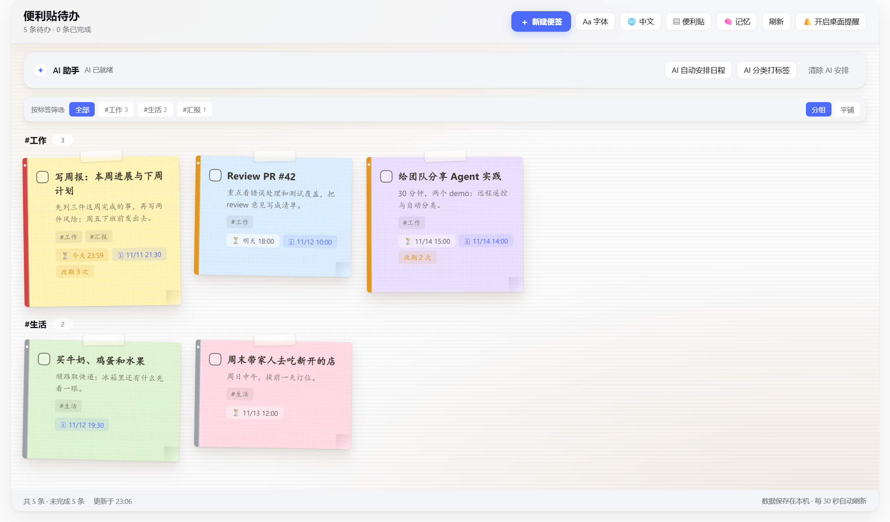
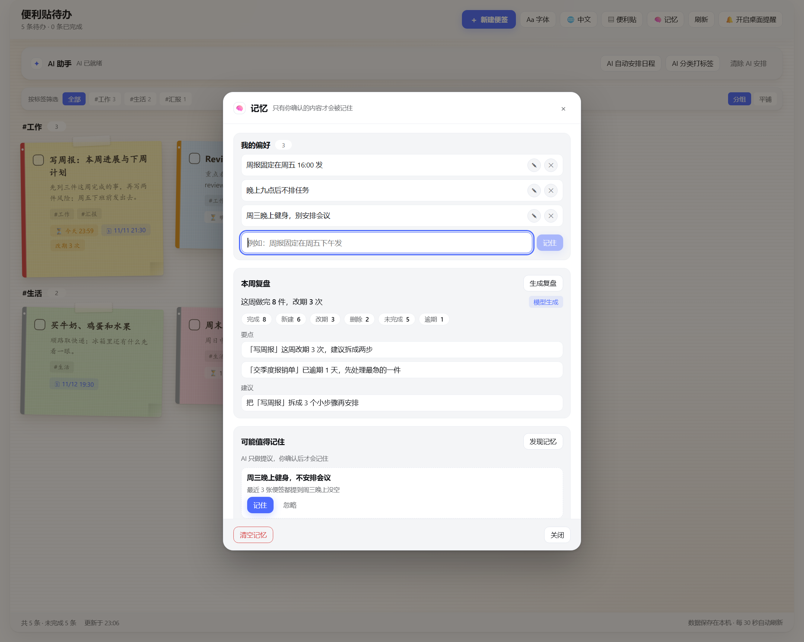

# Sticker TODO · 便利贴待办


[](https://www.npmjs.com/package/dsh-sticker-todo)
[](https://github.com/kevin-qiao/dsh-todo/actions/workflows/verify.yml)

[](https://dsh-plugin.org/plugins/kevin-qiao/dsh-todo)
[](./LICENSE)

[中文](./README.md)

A **DeepSeek Harness (DSH) Web plugin**: a sticky-note todo board in the left sidebar — bilingual, with AI that plans, classifies and coaches one note at a time, and a memory that survives restarts.

## Preview

| Sticky board | Memory: preferences, weekly review, AI proposals |
|---|---|
|  |  |

> Screenshots use demo data; the whole UI switches between 中文 and English.

## Features

- **Two views**: sticky board (default) and a minimal list that shows titles only until you expand a row.
- **Composer dialog**: title + details, colour, priority (visual only), today / tomorrow / in 2 days / next week quick due dates, timed reminders, up to 3 tags.
- **Organisation**: filter by tag, group by tag, a place for finished notes.
- **Look and feel**: font presets (handwritten CJK / 行楷 / UI font), language (auto / 中文 / English), tasteful motion that respects `prefers-reduced-motion`.
- **AI**: schedule planning, tag classification (**only untagged notes are classified**), and a per-note coach that offers 2–4 pickable answers, up to 3 rounds, with an editable suggestion.
- **Memory**: postponement / completion history, editable preferences, a weekly review, and a coaching conversation that resumes after a restart; notes postponed twice or more show `改期 N 次`.
- **Hand off to DSH**: the `↗` action turns the note — title, details, due, priority, tags and id — into a prompt in the main chat draft. It never sends.
- **Agent tool**: `sticker_todo` — `list` / `add` / `update` / `complete` / `remove` / `clear_completed` / `plan` / `advice` / `tag` / `remember` / `forget` / `memories` / `review`.

## Install

```powershell
dsh plugin --profile web add dsh-sticker-todo
```

Restart DSH afterwards. The entry lives in the left sidebar; all data stays on this machine.

<details>
<summary>Install from source</summary>

```powershell
git clone https://github.com/kevin-qiao/dsh-todo.git
dsh plugin --profile web add link:D:\path\to\dsh-todo
```
</details>

## Usage

- **Header**: `＋ New note`, `Aa Font`, language (Auto / 中文 / English), `Sticky / Minimal`, `🧠 Memory`, `Refresh`.
- **Note actions**: `✦` coach advice, `↗` hand off to DSH, `⏰` remind in 1 hour, edit, two-step delete.
- **AI card**: plan the schedule, classify tags (untagged notes only), clear the plan.
- **Memory**: manage preferences, generate a weekly review and confirm AI-proposed facts under `🧠 Memory`; 清空记忆 clears the history but keeps the notes.

## Data

- Default file `~/.dsh-sticker-todo/todos.json` (override with `dataFile`), rewritten atomically.
- Document v2: `{ version: 2, todos, events, memory: { facts, threads } }`. A v1 file migrates automatically and an older plugin still reads only `todos`, so downgrading never loses notes.
- When the model is unavailable, slow, or returns unusable output, every AI action degrades to a deterministic local rule marked `source: "fallback"` — it never throws.
- Deleting the file resets everything; 清空记忆 clears only events, preferences and threads.

## Development

```powershell
node verify/check-static.mjs    # 71 checks: manifest, contract, version, zero deps
node verify/host-actions.mjs    # 49 checks: HTTP route, AI fallbacks, tool, memory
node verify/client-render.mjs   # 58 checks: client render smoke
node verify/api-smoke.mjs http://127.0.0.1:<port>   # 28 checks: live GUI smoke
```

Zero runtime dependencies, Node ≥ 20. CI runs the first three suites on Node 20 / 22 / 24.

## Docs

- [`CONTRACT.md`](./CONTRACT.md): the Host ↔ Client API contract and per-round changes
- [`docs/MEMORY.md`](./docs/MEMORY.md): memory design, boundaries and data model
- [`HANDOFF.md`](./HANDOFF.md): maintenance, release flow, troubleshooting

## License

[MIT](./LICENSE) © 2026 Kevin. The icon is original artwork; DeepSeek Harness is licensed separately.
