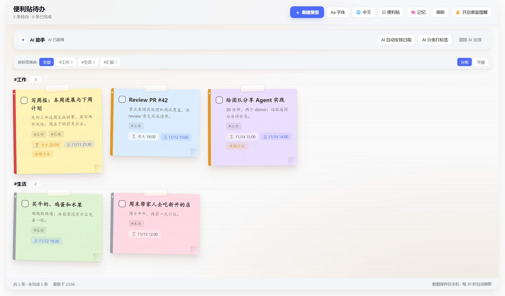
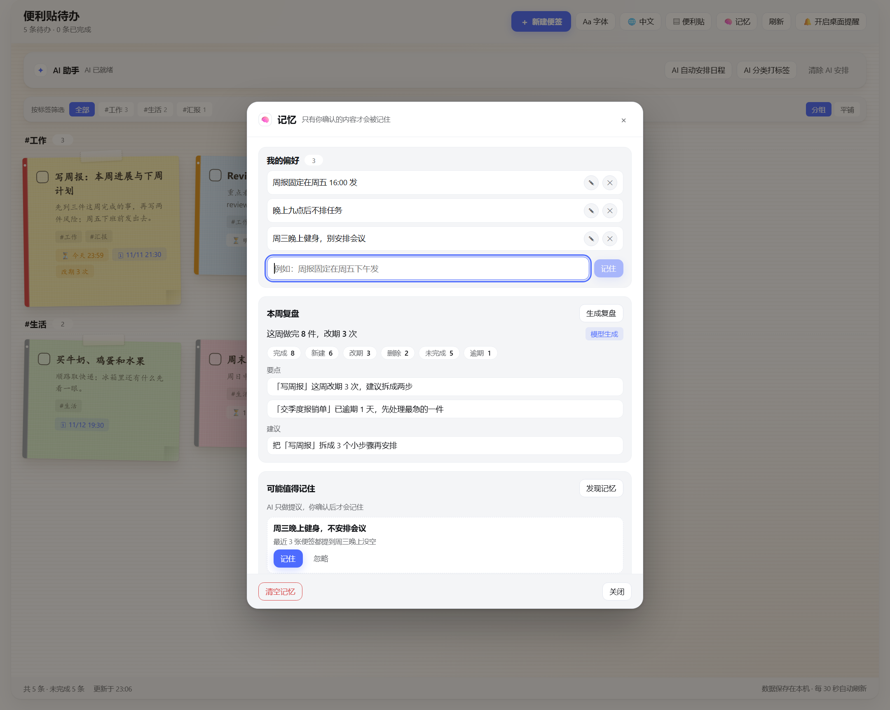

# 便利贴待办 · Sticker TODO


[](https://www.npmjs.com/package/dsh-sticker-todo)
[](https://github.com/kevin-qiao/dsh-todo/actions/workflows/verify.yml)

[](https://dsh-plugin.org/plugins/kevin-qiao/dsh-todo)
[](./LICENSE)

[English](./README.en.md)

DeepSeek Harness（DSH）Web 插件：在左侧栏加一面**便利贴待办墙** —— 中英双语，AI 帮你排程、分类、逐条商量，还会记住你的习惯。

## 预览

| 便签板 | 记忆：偏好、周复盘、AI 提议 |
|---|---|
|  |  |

> 截图为示例数据，界面可一切换中英双语。

## 特性

- **两种视图**：便利贴板（默认）/ 极简列表（只显示标题，点一下展开详情）。
- **新建弹窗**：标题 + 详情、颜色、优先级（仅视觉提示）、今天 / 明天 / 后天 / 下周快捷到期、定时提醒、最多 3 个标签。
- **组织**：标签筛选、按标签分组、已完成便签区。
- **界面**：字体预设（中文手写体 / 行楷 / UI 字体）、语言（自动 / 中文 / English）、顺滑动效并尊重 `prefers-reduced-motion`。
- **AI**：自动安排日程、分类打标签（**只处理还没标签的便签**）、单条便签教练（先给 2–4 个可点选答案，最多 3 轮，建议可编辑）。
- **记忆**：改期与完成的历史、可编辑的偏好、本周复盘、教练对话跨会话续聊；被改期两次以上显示「改期 N 次」。
- **交给 DSH**：便签上的 `↗` 把标题、详情、截止、优先级、标签和 id 拼成一段 prompt 放进主对话框草稿，**不自动发送**。
- **Agent 工具**：`sticker_todo` —— `list` / `add` / `update` / `complete` / `remove` / `clear_completed` / `plan` / `advice` / `tag` / `remember` / `forget` / `memories` / `review`。

## 安装

```powershell
dsh plugin --profile web add dsh-sticker-todo
```

装完重启 DSH。入口在左侧栏「便利贴待办」，数据存在本机。

<details>
<summary>从源码安装</summary>

```powershell
git clone https://github.com/kevin-qiao/dsh-todo.git
dsh plugin --profile web add link:D:\path\to\dsh-todo
```
</details>

## 使用

- **头部**：`＋ 新建便签`、`Aa 字体`、语言（自动 / 中文 / English）、`便利贴 / 极简`、`🧠 记忆`、`刷新`。
- **便签动作**：`✦` 教练建议、`↗` 交给 DSH、`⏰` 一小时后提醒、编辑、两步删除。
- **AI 卡片**：自动安排日程、分类打标签（只补未分类的）、清除安排。
- **记忆**：`🧠 记忆` 里管理偏好、生成周复盘、查看 AI 提议（点「记住」才落盘）；「清空记忆」只清历史，便签不动。

## 数据

- 默认 `~/.dsh-sticker-todo/todos.json`（可用 `dataFile` 改），每次修改原子写入。
- 文档 v2：`{ version: 2, todos, events, memory: { facts, threads } }`；旧文件自动迁移，旧版插件仍只读 `todos`，降级不丢便签。
- AI 不可用（没配模型、超时、输出不合规）时全部降级为本地规则并标 `source: "fallback"`，不会报错。
- 删掉该文件会连便签一起重置；`清空记忆` 只清事件、偏好与对话。

## 开发

```powershell
node verify/check-static.mjs    # 71 项：清单、契约、版本、零依赖
node verify/host-actions.mjs    # 49 项：HTTP 路由、AI 降级、工具、记忆
node verify/client-render.mjs   # 58 项：客户端渲染冒烟
node verify/api-smoke.mjs http://127.0.0.1:<端口>   # 28 项：对运行中的 GUI 冒烟
```

零运行时依赖，Node ≥ 20；CI 在 Node 20 / 22 / 24 上跑前三套。

## 文档

- [`CONTRACT.md`](./CONTRACT.md)：Host ↔ Client 的 API 契约与逐轮变更
- [`docs/MEMORY.md`](./docs/MEMORY.md)：记忆功能的设计、边界与数据模型
- [`HANDOFF.md`](./HANDOFF.md)：维护交接、发版流程、排障

## 许可

[MIT](./LICENSE) © 2026 Kevin。图标为原创；DeepSeek Harness 本身另有许可。
