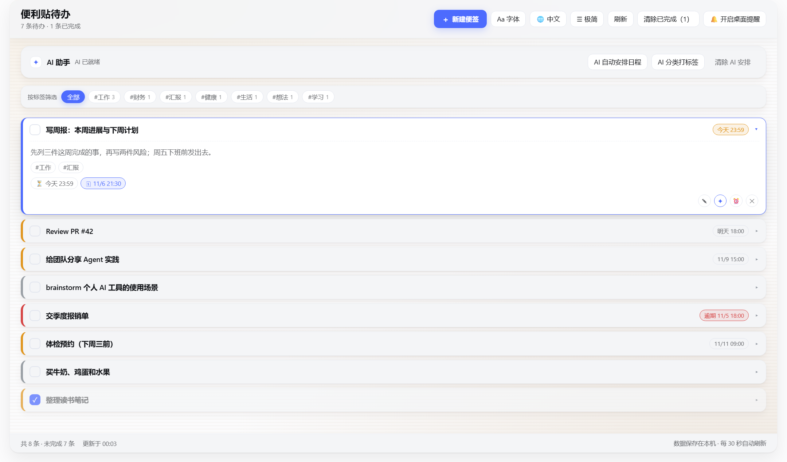
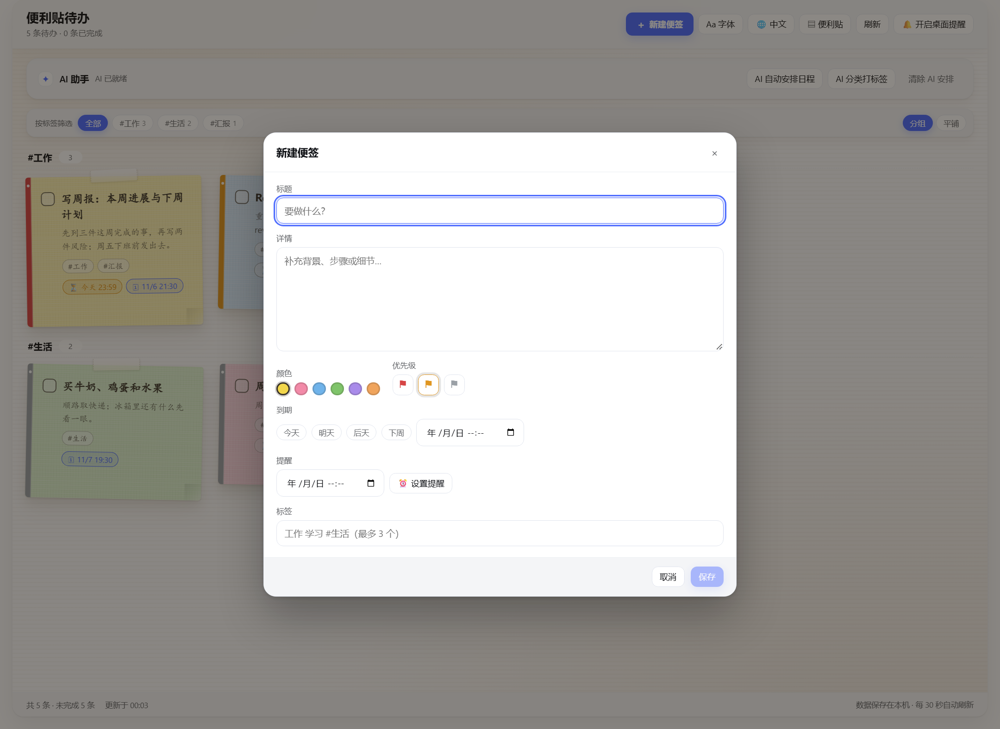

# 便利贴待办 · Sticker TODO


A **bilingual sticky-note todo board** for the DeepSeek Harness Web GUI.
DeepSeek Harness Web GUI 里的一块便利贴待办板 —— 中英双语、随手贴、AI 帮忙整理。


[](https://www.npmjs.com/package/dsh-sticker-todo)


[](https://github.com/kevin-qiao/dsh-todo/actions/workflows/verify.yml)
[](https://dsh-plugin.org/plugins/kevin-qiao/dsh-todo)

**English** · [中文](https://github.com/kevin-qiao/dsh-todo/blob/main/README.zh-CN.md)

## Preview

| Sticky board | Minimal list (click a row to expand) |
|---|---|
|  |  |




> Screenshots use demo data; the UI is bilingual and switches from the header. · 截图为示例数据，界面支持中英双语切换。

## What it is

`dsh-sticker-todo` is a DeepSeek Harness (DSH) Web plugin: it adds a **便利贴待办 (Sticker TODO)**
entry to the left sidebar, opening a paper-walled board of sticky notes. Each note has a title,
details, colour, priority, deadline, timed reminder and tags; AI can plan the schedule, classify the
board into tags, and advise on **one note at a time** — asking a few pick-or-type questions first when
it needs context. Since v1.7.0 it also **remembers**: a completion / postponement history, editable
preferences, a weekly review, and a coach conversation that survives restarts. The panel, the HTTP
route and the agent tool share one Host implementation, so the chat and the panel can never disagree.

## Features

- **Composer dialog** — the header button `＋ 新建便签` opens a dialog with a title (required), a large
  details area, colour, priority, quick due dates, reminder and tags; editing reopens the same dialog.
- **Quick due dates** — 今天 / 明天 / 后天 / 下周 one-click chips (that day at 23:59 local; 下周 = next
  Monday 23:59) plus a custom date-time control.
- **Visual-only priority** — a colour-coded edge and flag encode high/medium/low; no text on the board
  (screen readers still get the label).
- **Timed reminders** — in-panel banner, a frame-wide bottom-right card and (when permitted) a desktop
  notification; nothing is acknowledged until you dismiss it.
- **Tags & grouping** — up to three `#tags` per note, a tag filter, and an automatic per-tag grouped
  layout after AI classification (with a flat toggle).
- **Font presets** — `default` (UI font for Latin + handwritten KaiTi for CJK), `hand`, `xingkai`,
  `ui`; applied to note text only and remembered.
- **Bilingual UI** — a header language switch: `自动` (follow the DSH locale) / `中文` / `English`;
  every label and every date format follows it, and the choice is remembered.
- **Two display formats** — a header view switch: `便利贴` (the sticky board) and `极简` (a compact
  title-only list). In minimal mode a row expands in place to show its details, tags, dates and
  actions (one row at a time); the choice is remembered.
- **AI schedule planning** — plans start times (`planAt`) backwards from deadlines.
- **AI tag classification** — assigns 1–3 category tags to the open notes **that have no tags yet**
  and returns a grouping summary; notes you already tagged are left untouched, so re-running the
  pass only fills the gaps (an all-tagged board says so instead of reclassifying anything).
- **「交给 DSH」handoff** — the `↗` action on any note (sticky card or expanded minimal row) builds a
  prompt from the note — title, details, deadline / priority / tags, note id — and puts it into the
  DSH chat draft without sending it. When the optional `uiWorkspace` service is unavailable it copies
  the prompt to the clipboard instead, with a toast either way.
- **Per-note AI advice** — the `✦` button on each note: the model answers with one short, concrete
  suggestion when it has enough context, or asks up to three questions first. Every question comes
  with **2–4 pickable answers plus a free-text box**; the final advice is editable and can be appended
  to the note's details with one click.
- **Memory** — the header `🧠 记忆` dialog remembers what matters: **我的偏好** holds editable facts
  injected into every AI prompt; **本周复盘** derives a weekly review (completed / created / postponed /
  removed, plus open and overdue) from the event log; **可能值得记住** lets the AI *propose* facts —
  nothing is stored until you click 记住. A two-step 清空记忆 wipes the history. Each note's coaching
  conversation and its last advice survive restarts: reopen `✦` and use `继续聊聊` to carry on instead
  of starting over. Notes postponed twice or more show a `改期 N 次` badge.
- **Motion & polish** — staggered note entrances, dialog transitions, hover/focus micro-interactions,
  AI loading shimmer; everything respects `prefers-reduced-motion` and animates only
  `transform`/`opacity`.
- **Agent integration** — the same board is exposed to the model through the `sticker_todo` tool.

## Requirements

| Item | Requirement |
|---|---|
| DeepSeek Harness | Desktop app with its Web GUI |
| OS | Windows / macOS / Linux (the handwritten CJK default uses KaiTi; system fallbacks otherwise) |
| Node.js (verify scripts only) | ≥ 18 (developed on 24) |
| Model | Optional — every AI feature falls back to a deterministic local rule and reports `source: "fallback"` |

## Install

The plugin is a standard DSH bundle (it ships `dsh.bundle.patch` and a `dsh.client` manifest) and is
published to npm as **`dsh-sticker-todo`**:

```bash
dsh plugin --profile web add dsh-sticker-todo
```

Then **restart DSH** (the Host half is loaded from disk only at startup) and open **便利贴待办** in the
sidebar.

<details>
<summary>Install from source instead (GitHub / local checkout / manual profile link)</summary>

```bash
dsh plugin --profile web add github:kevin-qiao/dsh-todo
```

or clone the repository and install that checkout:

```bash
git clone https://github.com/kevin-qiao/dsh-todo.git
```

1. Install the cloned directory from the DSH **Plugin Manager** (`install_bundle`, target = that local
   path), or add `dsh-sticker-todo` to `dsh.profile.bundles` with a `link:<clone-dir>` dependency.
2. Restart DSH.
3. The sidebar entry appears; open it and start writing notes.

After that, `client.js`-only changes need a page reload (Ctrl+R); `index.js` / `lib/*` changes need a
DSH restart or a Plugin Manager reinstall.

</details>

## Configuration

Optional plugin-row config:

| Field | Default | Meaning |
|---|---|---|
| `dataFile` | `~/.dsh-sticker-todo/todos.json` | Where the board is stored |
| `aiTimeoutMs` | `30000` | Model-call timeout (3 s – 3 min) before the local fallback runs |

AI calls use the model selected as DSH's current default model.

## Usage

- **Create / edit** — `＋ 新建便签`; fill title, details, colour, priority, due, reminder, tags; save.
- **Card actions** — toggle done, edit, `✦` AI advice, remind in 1 hour, focus, two-step delete.
- **Filter / grouping** — the filter row narrows the board by tag; `分组/平铺` switches the layout.
- **Font / language / view** — `Aa 字体`, the language switch (`自动` / `中文` / `English`) and the
  view switch (`便利贴` sticky board / `极简` minimal list with click-to-expand rows).
- **AI card** — schedule, classify & tag (only untagged notes), clear plan.
- **交给 DSH** — `↗` on a card (or in an expanded minimal row) puts the note into the chat draft as a
  prompt; review it in the composer and press Enter when you are ready.
- **AI advice** — `✦` on a card; pick a suggested answer or type your own, then edit the advice and
  append it to the note.
- **Memory** — `🧠 记忆` in the header: add / edit / forget preferences, generate a weekly review,
  discover AI-proposed memories (记住 or 忽略), and clear the history with the two-step 清空记忆.
  A note postponed at least twice shows a `改期 N 次` chip; reopen a coached note to `继续聊聊`.

## Data

- Default file `~/.dsh-sticker-todo/todos.json`, rewritten atomically (temp + rename) after each change.
- The document is **v2** since v1.7.0: `{ version: 2, todos, events, memory: { facts, threads } }`.
  A v1 file loads unchanged with empty memory and is upgraded on the next write; an older plugin
  ignores the extra members, so downgrading never loses notes.
- Memory contents: the event log (≤ 2000 events, ring), user facts (≤ 50, each 1–120 characters) and
  per-note advice threads (≤ 200, each with ≤ 3 Q&A rounds and the last advice). `postpones`,
  weekly statistics and `averageOpenAgeDays` are derived on read and never persisted.
- Every timestamp is an ISO-8601 string (`dueAt` / `remindAt` / `remindFiredAt` / `planAt` / event and
  fact `at`, `createdAt`, `updatedAt`) or `null`.
- **Clearing / resetting**: `🧠 记忆 → 清空记忆` (or `POST {action:'clearMemory'}`) drops events, facts
  and threads but keeps every note. Deleting `~/.dsh-sticker-todo/todos.json` resets everything,
  notes included.

## Project layout

```
dsh-to-do/
├── index.js            # Host entry: store, sticker_todo tool, /dsh-todo HTTP API
├── lib/
│   ├── store.js        # JSON document, validation, sorting, reminder selection, tag rules
│   ├── ai.js           # model planning / tagging / per-note advice + local fallbacks
│   └── tools.js        # the model-facing sticker_todo tool
├── client.js           # browser half: sidebar entry, board, dialogs, AI advice, motion
├── cordis.patch.yml    # bundle patch inserting the sticker-todo row
├── locale/{zh,en}.json # Plugin Manager title and description
├── icon.svg            # plugin icon
├── verify/             # offline manifest / offline host integration / client render / live HTTP smoke
├── docs/               # README preview images + MEMORY.md (memory design notes)
├── CONTRACT.md         # shared Host ↔ Client contract
└── HANDOFF.md          # maintainer hand-off notes
```

## Architecture

```text
Browser (client.js)                      Host (index.js)
  panel / sidebar icon                     store (lib/store.js) ⇄ todos.json
  POST /dsh-todo/action  ────────────▶     runAction()  ──▶ store / lib/ai.js
  GET  /dsh-todo/state   ◀────────────     readState()  ──▶ sorted todos + reminders + ai status
                                                     ▲
                                          sticker_todo tool (lib/tools.js) ── agent
```

- The browser half never owns data: it reads `GET /dsh-todo/state` and writes
  `POST /dsh-todo/action`.
- Panel buttons, HTTP routes and the `sticker_todo` tool all run the same `runAction`, so they cannot
  diverge.
- Reminders are polled at plugin scope every 30 s and fire from any panel.

## AI & fallbacks

| Capability | Route | On failure |
|---|---|---|
| Schedule planning | `POST {action:'aiPlan'}` | deterministic local scheduler, `source: "fallback"` |
| Tag classification | `POST {action:'aiTag'}` | local keyword classifier, `source: "fallback"`; only untagged open notes are classified |
| Per-note advice | `POST {action:'aiNoteAdvice'}` | local advice text, `source: "fallback"`, asks nothing |
| Weekly review | `POST {action:'review'}` | deterministic review derived from the event log, `source: "fallback"` |
| Memory candidates | `POST {action:'memoryCandidates'}` | local patterns only (postpone ≥ 3, a tag on ≥ 3 notes, chronic overdue), never stored |

Per-note advice asks at most three questions; a fourth model question is rejected by the Host and
answered with advice. Questions always carry 2–4 options — a question without valid options is
rejected and degraded to advice, so the UI never shows empty choices. The model may only *propose*
memory facts through `memoryCandidates`; a proposal is written only when the user confirms it with
`remember`.

## Agent tool

The `sticker_todo` tool exposes the board to the model:
`list` · `add` · `update` · `complete` · `remove` · `clear_completed` · `plan` · `advice` · `tag` ·
`remember` · `forget` · `memories` · `review`

Read results also echo `memory: { facts: string[], stats }`, so “how did my week go” needs one call.
Examples: “plan my week”, “group my todos by topic”, “mark 写周报 as done”, “remember that I send the
weekly report on Friday afternoons”.

## HTTP API

One prefix route: `GET /dsh-todo/state` and `POST /dsh-todo/action`, with the actions
`add` / `update` / `toggle` / `remove` / `clearCompleted` / `ackReminders` / `aiPlan` / `aiAdvice` /
`aiClearPlan` / `aiTag` / `aiNoteAdvice` / `remember` / `updateFact` / `forget` / `review` /
`memoryCandidates` / `clearMemory`. `state` also returns the `memory` block.
Full shapes and error codes live in
[`CONTRACT.md`](https://github.com/kevin-qiao/dsh-todo/blob/main/CONTRACT.md).

## Development & verification

No build step (`client.js` is a plain browser module; the Host is native ESM). After a change:

```bash
node verify/check-static.mjs      # manifest / patch / locales / icon / syntax
node verify/host-actions.mjs      # offline Host integration (real apply() + scripted model)
node verify/client-render.mjs     # client render smoke (real components, shimmed React)
node verify/api-smoke.mjs http://127.0.0.1:55609   # live HTTP smoke (use the actual port)
```

All four scripts are dependency-free and use Node built-ins only. The first two never touch the
network or files outside the repo; `api-smoke` only creates and removes its own test notes, restores
pre-existing tags after the `aiTag` check, and never deletes the user's finished notes.

Baseline (v1.8.0): `check-static` 71 checks, `host-actions` 49, `client-render` 58, `api-smoke` 28
(27 pass + 1 SKIP while the running Host predates v1.8.0; 28/28 after a DSH restart) — all passing
(`api-smoke` varies a little with the board contents and may SKIP a check that would protect user
data; it forgets its temporary memory fact and removes every note it creates).

## FAQ

- **AI buttons give local-rule results?** No default model is configured, or the call timed out; check
  `source: "fallback"`.
- **“Restart DSH to enable this”?** The running Host still predates the feature; the Host reloads only
  at DSH startup.
- **Chinese is handwritten but English is sans-serif?** That is the `default` font preset; switch to
  `ui` for a uniform UI font.
- **How do I change the language?** Use the header language switch; `自动` follows the DSH locale.
- **What exactly is remembered?** The event history, the preferences you confirm, the weekly review
  data and each note's coaching conversation; the model may only *propose* facts, never write them.
  Open `🧠 记忆` to review or delete them, or 清空记忆 to drop all history (notes are kept).
- **Where are the notes?** `~/.dsh-sticker-todo/todos.json` (override with `dataFile`).

## Contributing

- Development setup, verification commands and code conventions: [CONTRIBUTING.md](https://github.com/kevin-qiao/dsh-todo/blob/main/CONTRIBUTING.md)
- Please report security issues privately per [SECURITY.md](https://github.com/kevin-qiao/dsh-todo/blob/main/SECURITY.md), not in a public issue;
- Questions, setups and ideas are welcome in
  [Discussions](https://github.com/kevin-qiao/dsh-todo/discussions); use the issue templates for bugs
  and feature requests;
- Version history: [CHANGELOG.md](https://github.com/kevin-qiao/dsh-todo/blob/main/CHANGELOG.md).

## License

[MIT](https://github.com/kevin-qiao/dsh-todo/blob/main/LICENSE) © 2026 Kevin. Published to npm as
[`dsh-sticker-todo`](https://www.npmjs.com/package/dsh-sticker-todo). The icon is original artwork;
the plugin runs inside DeepSeek Harness, which is licensed separately.

---

[中文版说明 README.zh-CN.md](https://github.com/kevin-qiao/dsh-todo/blob/main/README.zh-CN.md)
