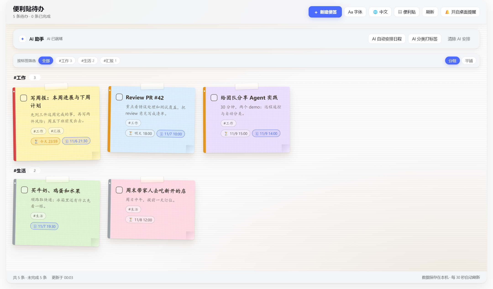
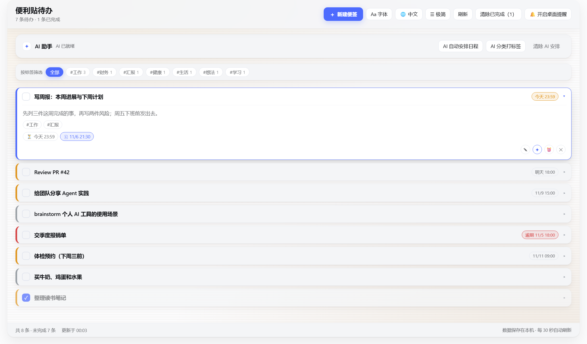
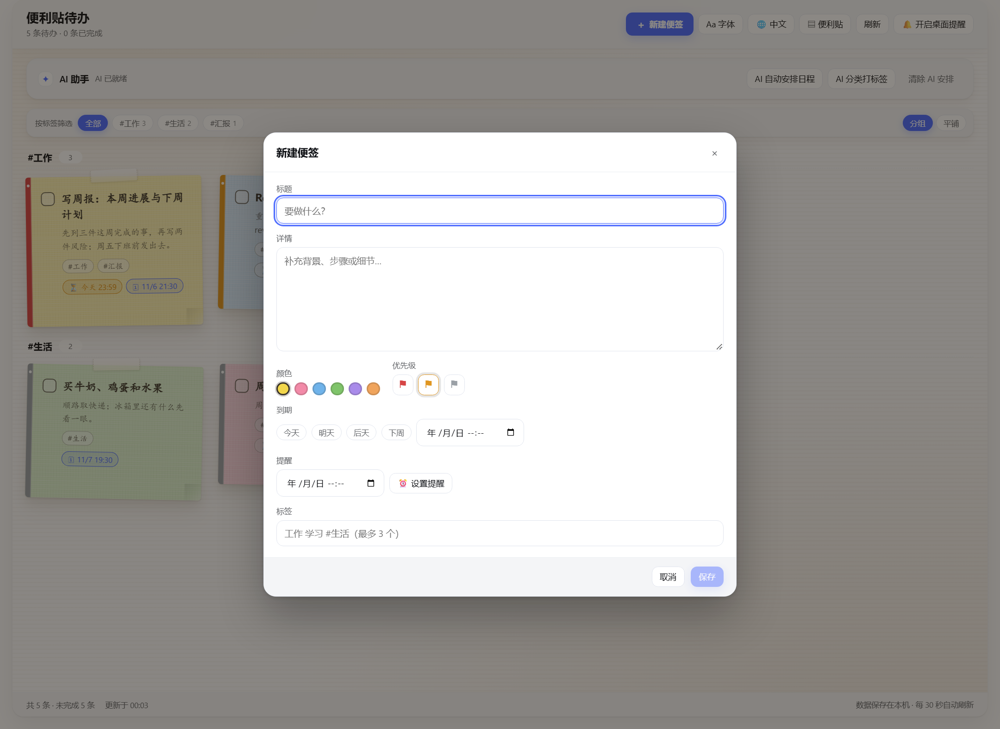
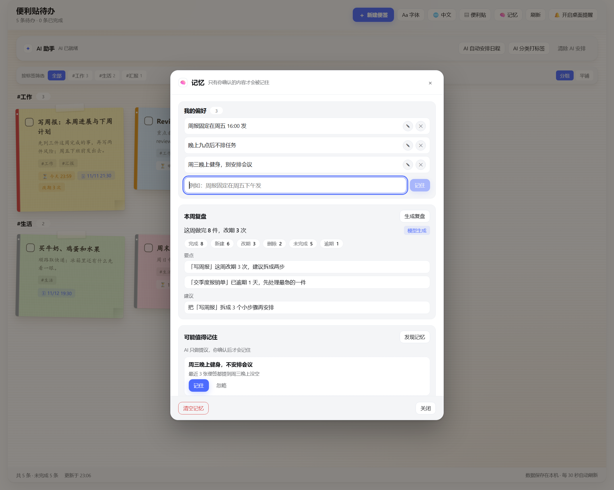

# 便利贴待办 · Sticker TODO


DeepSeek Harness Web GUI 里的一块**中英双语便利贴待办板** —— 随手贴、AI 帮忙整理。
A **bilingual sticky-note todo board** for the DeepSeek Harness Web GUI.


[](https://www.npmjs.com/package/dsh-sticker-todo)


[](https://github.com/kevin-qiao/dsh-todo/actions/workflows/verify.yml)
[](https://dsh-plugin.org/plugins/kevin-qiao/dsh-todo)

[English](https://github.com/kevin-qiao/dsh-todo/blob/main/README.md) · **中文**

## 预览

| 便利贴视图 | 极简列表（点行展开） |
|---|---|
|  |  |





> 截图为示例数据；界面支持中英双语，可通过面板头部按钮切换。

## 简介

`dsh-sticker-todo` 是一个 DeepSeek Harness（DSH）Web 插件：在左侧栏加一个「便利贴待办」入口，
点开后是一面纸质背景的便利贴墙。每张便签有标题、详情、颜色、优先级、截止日期、定时提醒和标签；
AI 可以帮你安排日程、按主题分类打标签，也能对**单条便签**给建议——信息不够时会先问你几个选择题。
从 v1.7.0 起它还会**记住**：改期与完成的历史、可编辑的偏好、每周复盘，以及关掉再打开还能接着聊的
教练对话。面板、HTTP 路由和 agent 工具共用同一份 Host 实现，聊天里改的和面板里看到的永远一致。

## 功能特性

- **弹窗式新建便签** — 头部主按钮「＋ 新建便签」打开弹窗：标题（必填）+ 大块详情输入区 + 颜色 +
  优先级 + 快捷到期 + 提醒 + 标签；编辑复用同一个弹窗。
- **快捷到期** — 今天 / 明天 / 后天 / 下周 一键设置（当天 23:59；下周 = 下周一 23:59），
  也可以自定义任意日期时间。
- **优先级只靠视觉** — 左侧色条 + 小旗表达高/中/低，不出现文字（读屏仍有标签）。
- **定时提醒** — 到点后在面板顶部横幅、右下角全局提醒卡、以及（授权后）系统通知三处提醒；
  点「知道了」才确认，错过的提醒不会丢。
- **标签与分组** — 每条便签最多 3 个 `#标签`；按标签筛选；AI 分类后自动按分类分组显示，可切换平铺。
- **字体设置** — 四套预设：`默认`（英文界面字体 + 中文楷体手写）、`纯手写`、`行楷`、`界面字体`；
  只作用于便签正文，选择会记住。
- **双语界面** — 头部语言按钮：`自动`（跟随 DSH 界面语言）/ `中文` / `English`，
  所有界面文字与日期格式随语言切换，选择会记住。
- **两种展现格式** — 头部视图切换：`便利贴`（现在的便签墙）/ `极简`（只显示标题的紧凑列表）。
  极简模式下点一行就地展开详情、标签、时间和操作，再点收起；一次只展开一条，选择会记住。
- **AI 自动安排日程** — 读取未完成便签，按截止时间倒推，给出每条的开始时间（写入 `planAt`）。
- **AI 分类打标签** — 只给**还没有标签**的未完成便签打 1–3 个分类标签，并给一句分组总结；已经有标签
  的便签不会被覆盖，再跑一次只会补空缺（全部都有标签时直接回一句提示，不重新分类）。
- **「交给 DSH」** — 每张便签（便利贴卡片或极简展开行）上的 `↗`：把便签内容拼成 prompt —— 标题、详情、
  截止/优先级/标签、便签 id —— 放进 DSH 主对话框草稿，**不会自动发送**。可选的 `uiWorkspace` 服务不可用时
  改为复制到剪贴板，两种结果都有 toast 提示。
- **单条便签 AI 建议** — 每张便签上的 `✦`：模型信息足够就直接给一句可执行建议；不够就先问一个问题，
  最多 3 轮。每个问题都带 **2–4 个可点选的答案**，也可以自由输入；最终建议可编辑，一键「追加到备注」。
- **记忆** — 头部 `🧠 记忆` 弹窗把重要的东西记下来：**我的偏好** 是可增删改的事实，会注入每个 AI prompt；
  **本周复盘** 从事件流算出这一周（完成 / 新建 / 改期 / 删除，加上未完成与逾期）的复盘；**可能值得记住**
  由 AI *提议* 事实，你点「记住」才会真正保存（点「忽略」只在本机丢弃）。「清空记忆」两步确认清空历史。
  每条便签的教练对话与上次建议也跨会话保留：重新点开 `✦` 会直接显示上次建议，还可以「继续聊聊」。
  被改期两次及以上的便签会显示 `改期 N 次` 徽章。
- **动效与视觉** — 便签错峰淡入、弹窗开合、悬停/焦点过渡、AI loading shimmer；全部遵守
  `prefers-reduced-motion`，只用 `transform`/`opacity`，不卡顿。
- **Agent 协作** — 同一块看板通过 `sticker_todo` 工具暴露给模型，可以直接说
  “帮我把这周的事安排一下”“帮我把待办按主题整理打标签”。

## 环境要求

| 项 | 要求 |
|---|---|
| DeepSeek Harness | 桌面版，Web GUI（`dsh web` 或 Desktop 应用） |
| 系统 | Windows / macOS / Linux（中文手写默认用楷体，缺失时回退系统字体） |
| Node.js（仅跑校验脚本） | ≥ 18（开发时使用 24） |
| 大模型 | 可选。未配置或调用失败时所有 AI 功能自动降级为本地规则，并标注 `source: "fallback"` |

## 安装

插件是标准的 DSH bundle（`package.json` 带 `dsh.bundle.patch` / `dsh.client`），已发布到 npm，包名 **`dsh-sticker-todo`**：

```bash
dsh plugin --profile web add dsh-sticker-todo
```

然后**重启 DSH**（Host 侧模块只在启动时从磁盘加载），在左侧栏打开 **便利贴待办** 即可。

<details>
<summary>从源码安装（GitHub / 本地克隆 / 手动 profile 依赖）</summary>

```bash
dsh plugin --profile web add github:kevin-qiao/dsh-todo
```

或克隆仓库后安装该目录：

```bash
git clone https://github.com/kevin-qiao/dsh-todo.git
```

1. 在 DSH 的 **插件管理** 里安装克隆出来的目录（`install_bundle`，目标 = 该目录的本地路径）；
   或手动把 `dsh-sticker-todo` 加入 `dsh.profile.bundles`，依赖写成 `link:<克隆目录>`。
2. **重启 DSH**（Host 侧模块只在启动时从磁盘加载）。
3. 左侧栏出现「便利贴待办」入口，点开即用。

之后如果只改 `client.js`：刷新页面（Ctrl+R）即可；如果改了 `index.js` / `lib/*`：重启 DSH 或重装。

</details>

## 配置

插件行支持以下配置（都可选）：

| 字段 | 默认值 | 说明 |
|---|---|---|
| `dataFile` | `~/.dsh-sticker-todo/todos.json` | 便签数据文件路径 |
| `aiTimeoutMs` | `30000` | 单次模型调用的超时（3 秒 – 3 分钟），超时后走本地兜底 |

AI 使用的模型来自 DSH 当前的默认模型选择（设置里的默认模型）。

## 使用

- **新建/编辑**：`＋ 新建便签` 打开弹窗；填写标题、详情、颜色、优先级、到期、提醒、标签，保存。
- **卡片操作**：勾选完成、编辑、`✦` AI 建议、1 小时后提醒、定位、两步删除。
- **筛选/分组**：顶部筛选行按标签过滤；`分组/平铺` 切换布局。
- **字体**：`Aa 字体`；**语言**：语言按钮（自动/中文/English）；**视图**：便利贴 / 极简。
- **AI 卡片**：自动安排日程、分类打标签（只补没有标签的便签）、清除安排。
- **交给 DSH**：卡片上（或极简展开行里）的 `↗` 把这条便签作为 prompt 放进主对话框草稿；
  检查完在输入框里按回车再发送。
- **AI 建议**：卡片上的 `✦`，按提示点选答案或自由输入，最后可编辑建议并追加到备注。
- **记忆**：头部 `🧠 记忆` —— 增删改偏好、生成本周复盘、发现 AI 提议的记忆（记住 / 忽略），
  以及两步确认的「清空记忆」。改期两次及以上的便签显示 `改期 N 次`；教练对话过的便签可「继续聊聊」。

## 数据

- 默认 `~/.dsh-sticker-todo/todos.json`，每次修改原子写入（临时文件 + rename）。
- 从 v1.7.0 起文档是 **v2**：`{ version: 2, todos, events, memory: { facts, threads } }`。
  v1 文件读入时补空的 `events` / `memory`，首次写入自动升到 2；旧版插件会忽略多出来的成员，
  所以降级安装不会丢便签。
- 记忆内容：事件流（≤ 2000 条，环形丢最旧）、用户事实（≤ 50 条，每条 1–120 字）、
  每条便签的建议线程（≤ 200 条，每条最多 3 轮问答 + 上次建议）。`postpones`、周统计和
  `averageOpenAgeDays` 都是读时派生、不落盘。
- 时间字段一律 ISO-8601 字符串（`dueAt` / `remindAt` / `remindFiredAt` / `planAt`，以及事件与事实的
  `at` / `createdAt` / `updatedAt`），可为 `null`。
- **清空 / 重置**：`🧠 记忆 → 清空记忆`（或 `POST {action:'clearMemory'}`）只清事件、事实和建议线程，
  便签全都保留；要连便签一起重置，删除 `~/.dsh-sticker-todo/todos.json` 即可。

## 目录结构

```
dsh-to-do/
├── index.js            # Host 入口：store、sticker_todo 工具、/dsh-todo HTTP API
├── lib/
│   ├── store.js        # JSON 存储、校验、排序、提醒筛选、标签规范化
│   ├── ai.js           # 模型排程 / 标签分类 / 单条建议 + 本地兜底
│   └── tools.js        # 模型可见的 sticker_todo 工具
├── client.js           # 浏览器半边：侧栏入口、便签画板、弹窗、AI 建议、动效
├── cordis.patch.yml    # bundle patch，插入 sticker-todo 行
├── locale/{zh,en}.json # 插件管理器里的标题与描述
├── icon.svg            # 插件图标
├── verify/             # 离线清单 / 离线 Host 集成 / 客户端渲染 / 线上 HTTP 冒烟
├── docs/               # README 预览截图 + MEMORY.md（记忆设计说明）
├── CONTRACT.md         # Host ↔ Client 的共享契约（改代码前先看）
└── HANDOFF.md          # 维护者交接说明
```

## 架构

```text
Browser (client.js)                      Host (index.js)
  panel / sidebar icon                     store (lib/store.js) ⇄ todos.json
  POST /dsh-todo/action  ────────────▶     runAction()  ──▶ store / lib/ai.js
  GET  /dsh-todo/state   ◀────────────     readState()  ──▶ sorted todos + reminders + ai status
                                                     ▲
                                          sticker_todo tool (lib/tools.js) ── agent
```

- 浏览器半边不直接持有数据：读 `GET /dsh-todo/state`，写 `POST /dsh-todo/action`。
- 面板按钮、HTTP 路由、`sticker_todo` 工具都走同一个 `runAction`，三处状态不会分叉。
- 提醒由插件级 watcher 每 30 秒轮询，任何面板下都会触发。

## AI 与降级

| 能力 | 接口 | 失败时 |
|---|---|---|
| 排程 | `POST {action:'aiPlan'}` | 本地调度器，`source: "fallback"` |
| 分类打标签 | `POST {action:'aiTag'}` | 本地关键词分类器，`source: "fallback"`；只分类没有标签的未完成便签 |
| 单条便签建议 | `POST {action:'aiNoteAdvice'}` | 本地建议文本，`source: "fallback"`，不提问 |
| 本周复盘 | `POST {action:'review'}` | 从事件流推导的确定性复盘，`source: "fallback"` |
| 记忆候选 | `POST {action:'memoryCandidates'}` | 只按可核对模式生成（改期 ≥ 3 次、同一标签 ≥ 3 张、长期逾期），从不落盘 |

单条建议最多 3 轮提问；第 4 轮模型还想提问时会被 Host 拒绝并直接给建议。问题必带 2–4 个选项，
没有有效选项的问题会被拒绝并回退成建议，因此界面不会出现空选项。模型只能通过 `memoryCandidates`
*提议*记忆；只有用户调用 `remember`（面板里点「记住」）才会真正保存。

## Agent 集成

模型可以通过 `sticker_todo` 工具操作同一块看板，动作：
`list` · `add` · `update` · `complete` · `remove` · `clear_completed` · `plan` · `advice` · `tag` ·
`remember` · `forget` · `memories` · `review`

读类结果还会回带 `memory: { facts: string[], stats }`，所以「我这周做得怎么样」一次调用就能回答。
`tag` 动作与面板按钮行为一致：只给没有标签的未完成便签分类。

例：`帮我把这周的事安排一下`、`帮我按主题整理待办并打标签`、`把「写周报」标成完成`、
`记住我周五下午发周报`。

## HTTP API

只暴露一个 prefix 路由：`GET /dsh-todo/state` 与 `POST /dsh-todo/action`，动作包括
`add` / `update` / `toggle` / `remove` / `clearCompleted` / `ackReminders` / `aiPlan` / `aiAdvice` /
`aiClearPlan` / `aiTag` / `aiNoteAdvice` / `remember` / `updateFact` / `forget` / `review` /
`memoryCandidates` / `clearMemory`；`state` 还会返回 `memory` 块。
完整字段与错误码见 [`CONTRACT.md`](https://github.com/kevin-qiao/dsh-todo/blob/main/CONTRACT.md)。

## 开发与验证

无需构建（`client.js` 是普通浏览器模块；Host 是原生 ESM）。修改后：

```bash
node verify/check-static.mjs      # 清单 / patch / locale / icon / 语法
node verify/host-actions.mjs      # 离线 Host 集成（真跑 apply() + 脚本化模型）
node verify/client-render.mjs     # 客户端渲染冒烟（Node 里跑真组件）
node verify/api-smoke.mjs http://127.0.0.1:55609   # 线上 HTTP 冒烟（端口以实际为准）
```

四个脚本都是零依赖，只用 Node 内置模块；前两个不联网、不写仓库外文件，`api-smoke` 只操作自己创建的
测试便签并在结束时清理（不会删除你原有的已完成便签，`aiTag` 测试后会还原原标签；v1.7.0 的记忆检查只
创建一条明确标记的临时事实并在清理时 forget，绝不改动你自己的事实 / 线程 / 事件 / 便签）。

当前基线（v1.8.0）：`check-static` 71 项、`host-actions` 49 项、`client-render` 58 项、`api-smoke`
28 项（当前运行中的 Host 尚未加载 v1.8.0 时是 27 通过 + 1 SKIP，重启 DSH 后 28/28），全部通过
（`api-smoke` 的结果随看板数据略有浮动；为保护用户数据、或需要重启加载新 Host 代码的检查会 SKIP
而不是失败）。

## 常见问题

- **AI 按钮给的是本地规则结果？** 没配默认模型，或调用超时/失败；`source: "fallback"` 时用的是本地规则。
- **提示「重启 DSH 后可用」？** 线上 Host 还是旧代码。Host 侧只在 DSH 启动时加载，重启一次即可。
- **中文是手写体、英文是界面字体？** `Aa 字体` 的 `默认` 预设就是这样设计的；可切成 `界面字体`。
- **想换界面语言？** 面板头部的语言按钮可以切 `中文` / `English`，`自动` 跟随 DSH。
- **到底记了什么？** 事件历史、你确认过的偏好、周复盘数据和每条便签的教练对话；模型只能*提议*
  事实，不能自己写。点开 `🧠 记忆` 可以查看/删除，或用「清空记忆」清掉全部历史（便签保留）。
- **数据在哪？** `~/.dsh-sticker-todo/todos.json`，可以用行内配置 `dataFile` 改。

## 参与贡献

- 开发环境、验证命令和代码约定见 [CONTRIBUTING.md](https://github.com/kevin-qiao/dsh-todo/blob/main/CONTRIBUTING.md)；
- 安全漏洞请按 [SECURITY.md](https://github.com/kevin-qiao/dsh-todo/blob/main/SECURITY.md) 私密上报，不要开公开 issue；
- 使用问题、玩法分享和改进想法欢迎到 [Discussions](https://github.com/kevin-qiao/dsh-todo/discussions)
  讨论；功能与缺陷请用仓库里的 issue 模板提交；
- 版本变更见 [CHANGELOG.md](https://github.com/kevin-qiao/dsh-todo/blob/main/CHANGELOG.md)。

## 许可

[MIT](https://github.com/kevin-qiao/dsh-todo/blob/main/LICENSE) © 2026 Kevin。已发布到 npm：
[`dsh-sticker-todo`](https://www.npmjs.com/package/dsh-sticker-todo)。
图标为原创绘制；插件运行于 DeepSeek Harness，Harness 本身遵循其自身许可。

---

[English README](https://github.com/kevin-qiao/dsh-todo/blob/main/README.md)
